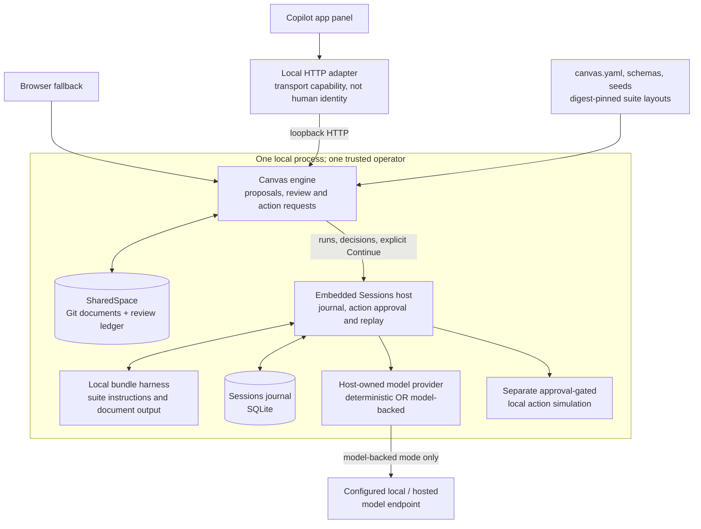
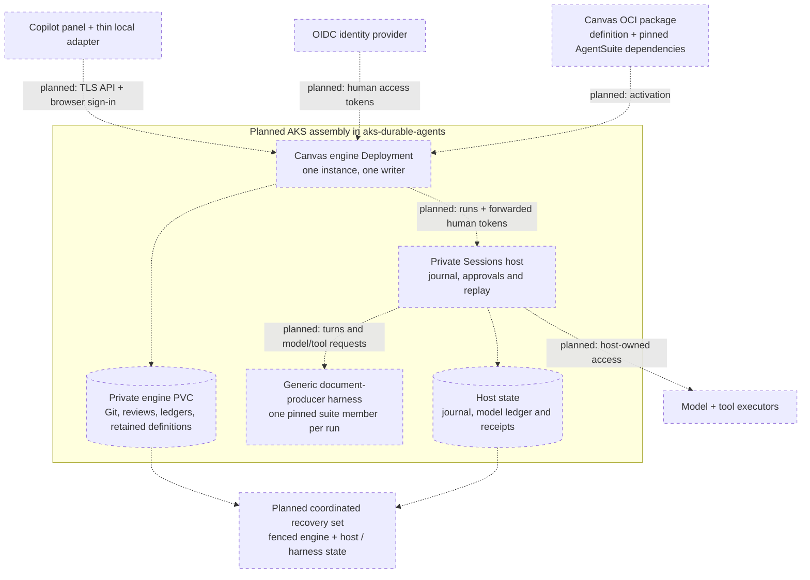

# Architecture

[Docs index](README.md) · [Canvas overview](../README.md)

Canvas owns document review; Sessions owns durable execution. The current local
path and the hosted direction below are different assemblies, not two supported
deployment options.

## Today: local engine with embedded Sessions

**Legend:** solid boxes and arrows describe implemented components and paths,
not live-model or deployment qualification. The Copilot demo uses the deterministic
provider; model-backed startup uses the same engine with a configured provider.
The panel and browser do not call Sessions or the model directly.
See the [local review guide](copilot-review.md) and
[model-backed setup](local-models.md) for their separate commands and state roots.

## Planned: separate hosted engine

This is the intended hosted assembly, **not an install guide**. Dashed boxes and
arrows mean planned assembly, packaging or integration, even where the underlying
engine or Sessions component already exists.

## Main boundaries

- **Documents:** SharedSpace owns accepted Git history, proposals and a separate review ledger; acceptance uses stale-base checks, not live co-editing.
- **Execution:** Sessions owns the journal and recorded replay; document history does not replace execution history.
- **Approvals:** accepting documents, approving an action and explicitly continuing are separate operations; approval alone does not execute a tool.
- **Human identity:** demo personas and Copilot sign-in are not authority; the opt-in [TLS/token-source path](authenticated-sessions.md) is not per-browser shared-user sign-in.
- **Hosted identity (planned):** Canvas obtains and forwards human tokens; Sessions verifies them directly where the provider issues Sessions-audience tokens, with operator-owned role policy.
- **Agents and models:** definitions pin suite members and document scopes; the current provider is host-owned, while sandboxed generic execution and host-mediated model/tool access are hosted integration work.
- **Recovery (planned):** keep one engine writer; fence and back up its whole private state together with Sessions journals, ledgers and receipts, then reconcile before enabling writes.

The current generic command rejects a remote Sessions address. A hosted engine,
Canvas OCI activation, browser sign-in, coordinated AKS restore and multi-reviewer
authorization remain work to do; see the [roadmap](../ROADMAP.md).
Git history is not a tamper-proof audit log, and a PVC alone is not writer fencing.
